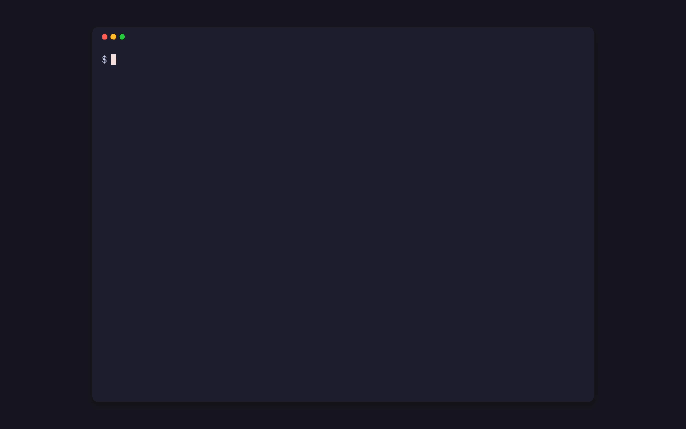
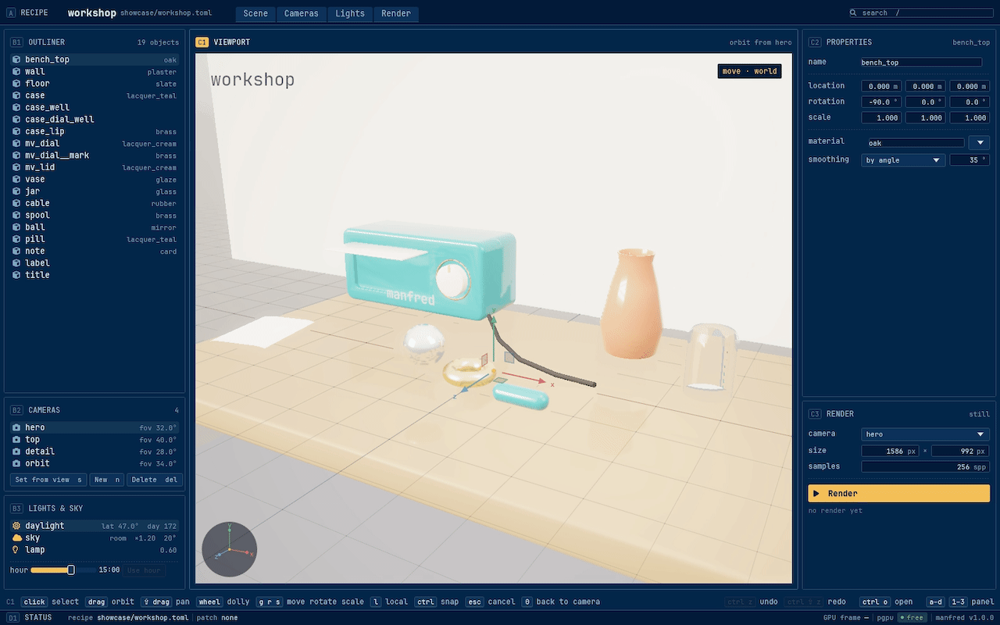
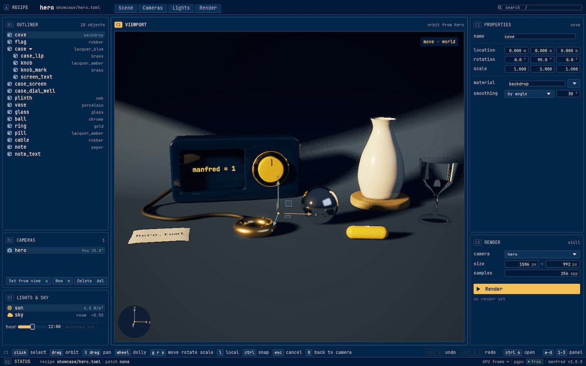
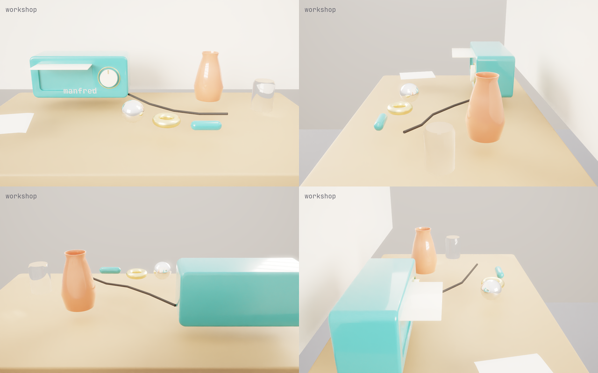
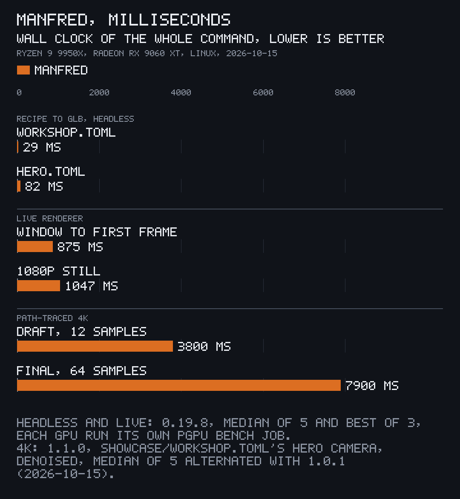
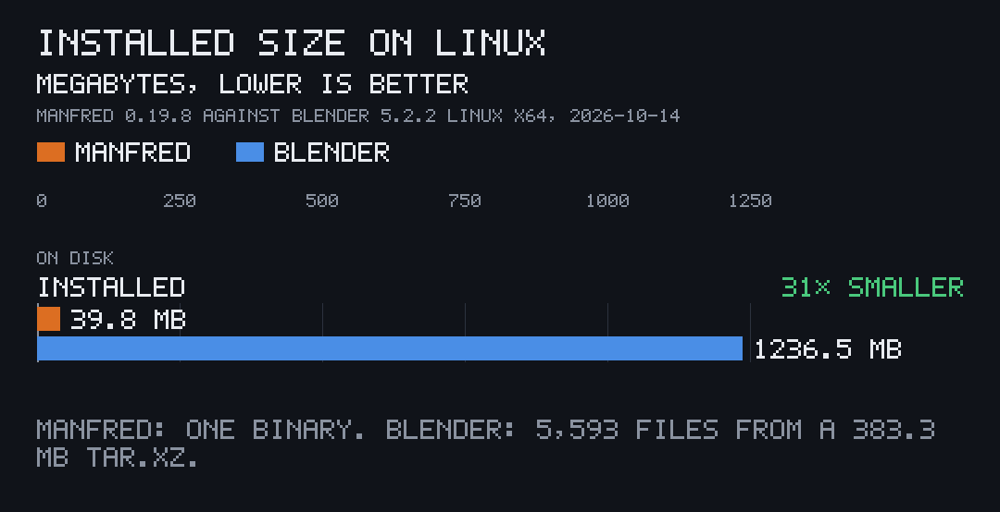

<p align="center"></p>

# Manfred

[](https://github.com/gmrdad82/manfred/actions/workflows/ci.yml) [](https://github.com/gmrdad82/manfred/tags)

Manfred is a lighter Blender, part of [PITO MD](https://pitomd.com): 3D scenes written as TOML recipes, built into GLB headless, arranged and lit in a live window, and path-traced into stills and clips on the GPU. No Blender anywhere: one 39.8 MB binary does it all.

- **31× smaller than Blender:** 39.8 MB, one file, against Blender 5.2.2's 1,236.5 MB in 5,593 files.
- **Recipe to GLB in 29 ms:** `showcase/workshop.toml`, 19 objects, 13 MB of memory at most, the same bytes on every run.
- **Window to first frame in 0.88 s,** the workshop scene loaded, built and drawn.
- **A 4K path-traced final in 7.9 s,** adaptive to 64 samples and denoised; a 4K draft in 3.8 s.

Every number is measured on a Ryzen 9 9950X with a Radeon RX 9060 XT on Linux; [Speed and size](#speed-and-size) says how.

<p align="center"></p>

Rendered by Manfred from [`showcase/hero.toml`](showcase/hero.toml), 314 lines of TOML.

## What it does

You describe a scene in a TOML recipe: its objects and how they are built, where they sit, the cameras, lights, sky, text and materials. Manfred builds it, shows it, lets you arrange it, and renders it, and the recipe stays the one source of truth. It is for people and AI agents alike, made with agentic development in mind: building 3D scenes as text (a game's set dressing, product shots, app icons and cards). Recipes diff and review like code, so a scene can live in a repository next to the program that uses it.

It is not a modeller: there is no sculpting and no hand mesh editing. Meshes come from Manfred's primitives (bevelled boxes, spheres, cylinders, tori, capsules, lathes, sweeps, pockets, cards and 3D text), from 2.5D outlines, or from generators an app writes in Rust.

### Recipes to GLB, headless

<p align="center"></p>

`manfred build` turns a recipe into a GLB and a JSON sidecar a game or app can load, with no window and no GPU, in milliseconds: 29 ms for the 19-object workshop, 82 ms for the hero scene. The build is deterministic, so the same recipe gives the same bytes on any machine, and a changed GLB in a diff is a changed scene. `manfred check` lists a recipe's problems at their line, and `manfred diff` compares two GLBs by structure, or draws both alike and compares them by PSNR.

### Arrange it in a live window

<p align="center"></p>

`manfred gui` opens the same recipe in a window drawn by the engine's live renderer, in 0.88 s from launch to the first frame. Pick a part in the viewport or the outliner, move, rotate and scale it with the gizmo or the panels, give it another material, set a camera from the view, and scrub the hour of the day to move the sun. Every edit is written straight back into the recipe file, keeping its comments and formatting, and Ctrl+Z puts it back.

### Path-traced stills

<p align="center"></p>

`manfred render` path-traces a still on the GPU with the engine's tracer (hardware ray queries, adaptive sampling, a port of Intel Open Image Denoise), headless or from the window's Render button. On the RX 9060 XT a 4K final of the workshop's hero camera takes 7.9 s, adaptive to 64 samples a pixel and denoised, and a 4K draft takes 3.8 s. It writes PNG, EXR or HDR, renders a crop of a bigger frame, and takes equirectangular and orthographic cameras.

### Camera clips

<p align="center"></p>

A camera with a path (an orbit, or keyframes) turns into frames with `manfred clip`, live or path-traced, and `--video clip.webm` encodes them through pconv. Above are four frames, a quarter turn apart, of a 180-frame orbit of the workshop traced at 32 samples a pixel. `manfred gui --clip` films the window itself playing a tape of clicks, keys and waits, frame by frame and byte for byte the same on every run: every window clip on this page is one of [showcase/](showcase/)'s tapes.

### Your app's own generators

An app links the `manfred` library into a small build binary of its own and registers what only it knows: generators that make meshes, the sidecar its loader reads, and its material catalogue. That binary is `manfred` with the app's names added ([docs/apps.md](docs/apps.md), [examples/app_build.rs](examples/app_build.rs)):

```rust
fn cube(call: &Call) -> Result<Vec<Piece>, String> {
    let name = call.params.get("name").and_then(|v| v.as_str()).ok_or("wants a `name`")?;
    let mut mesh = rounded_box([1.0; 3], 0.0, 1);
    mesh.set_material("cube");
    Ok(vec![Piece { name: name.to_string(), mesh }])
}

fn main() -> ExitCode {
    let mut registry = Registry::new();
    registry.register("app/cube", cube);
    let args: Vec<String> = std::env::args().skip(1).collect();
    manfred::cli::main(&args, &registry)
}
```

A recipe then asks for it with `kind = "generator"`, `generator = "app/cube"` and its `params`.

## Speed and size

<p align="center"></p>

<p align="center"></p>

| What | Number | How it was measured |
| --- | --- | --- |
| Binary | 39.8 MB, one file | the 0.19.8 release build (LTO, debug info stripped), as installed |
| Blender 5.2.2 | 1,236.5 MB in 5,593 files | `blender-5.2.2-linux-x64.tar.xz` (383.3 MB) from download.blender.org, unpacked |
| Recipe to GLB | 29 ms (workshop, 19 objects), 82 ms (hero, 18 objects) | `manfred build`, whole command, median of 5 runs |
| Peak memory of a build | 13 MB (workshop), 22 MB (hero) | the same runs' maximum resident set |
| Window to first frame | 875 ms | `manfred gui showcase/workshop.toml --shot`, offscreen at 1586x992, whole command, best of 3 |
| A live 1080p still | 1,047 ms | `manfred shot showcase/workshop.toml --camera hero --size 1920x1080`, whole command, best of 3 |
| 4K path-traced final | 7.9 s wall, 6.3 s on the GPU | the workshop's hero camera at 3840x2160, adaptive to 64 samples (59.9 a pixel on average), denoised; 1.1.0's release build, median of 5 runs alternated with 1.0.1's on a busy machine (load 6 to 22 on 32 threads) |
| 4K path-traced draft | 3.8 s wall, 1.5 s on the GPU | the same with `--draft`, adaptive to 12 samples (11.5 on average) |
| Code | 68,842 lines of Rust in 158 files, tests included | non-blank lines in the repository |
| Dependencies | pfx, its engine, and 16 maintained crates | direct dependencies of the workspace (clap, serde, serde_json, toml, toml_edit, egui, egui-wgpu, glam, gltf, gltf-json, png, exr, half, zune-jpeg, ttf-parser, i_overlay); 308 crates in the whole build |

The machine is a Ryzen 9 9950X with a Radeon RX 9060 XT (RADV) on Linux. GPU commands ran as their own job in the `pgpu` queue, so no other job shared the card; the 4K renders are the 0.19.8 release's speed budgets of 2026-10-12, and the rest was measured on 2026-10-14. The charts are drawn by [pito-compare](https://github.com/gmrdad82/pito-compare) from [docs/charts/](docs/charts/). Manfred runs only on Linux today, so no other GPU or OS is measured.

## Install

Manfred runs on Linux (x86_64) with a Vulkan GPU, and its window needs Wayland. It is built on [pfx](https://github.com/gmrdad82/pfx), and Windows and macOS are not supported today. Each [release](https://github.com/gmrdad82/manfred/releases/latest) carries a Linux binary with a `SHA256SUMS` file; it needs glibc 2.39 or newer (Ubuntu 24.04, Debian 13, Fedora 40 and later).

```
v=$(basename "$(curl -fsSLo /dev/null -w '%{url_effective}' https://github.com/gmrdad82/manfred/releases/latest)")
mkdir -p ~/.local/bin && curl -fsSL "https://github.com/gmrdad82/manfred/releases/download/$v/manfred-$v-linux-x86_64.tar.gz" | tar -xz -C ~/.local/bin manfred
```

`~/.local/bin` needs to be on your `PATH`. Then, in 30 seconds:

```
manfred gui                                               the window, on Manfred's own mark; Ctrl+O opens a recipe
git clone --depth 1 https://github.com/gmrdad82/manfred && cd manfred
manfred gui showcase/workshop.toml                        the workshop, live
manfred render showcase/hero.toml --camera hero --draft --out hero.png
```

**From source,** with Rust 1.97 or newer, `pkg-config` and the Wayland client library (`libwayland-dev` on Debian and Ubuntu):

```
cargo install --locked --git https://github.com/gmrdad82/manfred --tag vX.Y.Z manfred
```

Replace `vX.Y.Z` with a [release](https://github.com/gmrdad82/manfred/releases) tag.

Manfred can use three optional command-line tools when they are on the `PATH`, and works without them:

- `pgpu`, a GPU queue: when it is there, renders and clips wait their turn on it; without it they run at once, paced the same way.
- `pconv`, a video encoder for `manfred clip --video`: without it the frames and their ffconcat list are written, and any encoder, such as `ffmpeg -f concat -i frames.ffconcat clip.mp4`, makes the video.
- `pfx`, the engine's tool, bakes the light probes from the bake recipe `manfred build` writes.

## A first scene

Save this as `desk.toml`:

```toml
manfred = 1
name = "desk"

[output]
glb = "desk.glb"
sidecar = "desk.json"
sidecar_dialect = "facts"

[[object]]
name = "top"
kind = "plane"
size = [1.2, 0.8]
material = "oak"

[[object]]
name = "box"
kind = "box"
at = [-0.15, 0.05, 0.0]
size = [0.2, 0.1, 0.14]
bevel = { width = 0.01, segments = 4 }
material = "blue"

[[object]]
name = "ball"
kind = "sphere"
at = [0.15, 0.05, 0.05]
radius = 0.05
material = "brass"

[[camera]]
name = "main"
position = [0.0, 0.35, 0.7]
target = [0.0, 0.03, 0.0]
fov_y_deg = 35.0

[sun]
model = "authored"
toward = [-0.45, 0.82, 0.35]
color = [1.0, 0.92, 0.82]
irradiance = 2.2

[sky]
kind = "analytic"
intensity = 0.9

[materials.oak]
family = "wood"
base = [0.42, 0.28, 0.16]
roughness = 0.55

[materials.blue]
family = "lacquer"
base = [0.08, 0.2, 0.5]
roughness = 0.3

[materials.brass]
family = "metal"
base = [0.85, 0.66, 0.35]
roughness = 0.3
metalness = 1.0
```

Then:

```
manfred check desk.toml                                         lists any problems
manfred build desk.toml --out out                               writes out/desk.glb and out/desk.json
manfred shot desk.toml --camera main --size 800x500 --out desk.png
manfred render desk.toml --camera main --spp 256 --out desk-traced.png
manfred gui desk.toml                                           opens the window
```

`manfred gui` with no recipe opens on Manfred's own mark, the badge in 3D with its wordmark; Ctrl+O picks a recipe.

<p align="center"></p>

[docs/recipe.md](docs/recipe.md) is the whole schema, and [showcase/](showcase/README.md) has bigger scenes to open and render.

## Commands

```
manfred build <recipe> [--variant <name> | --all-variants] [--set key=value]... [--out <dir>]
                                                          recipe to GLB, sidecar and bake recipe
manfred check <recipe>                                       validate and list problems
manfred diff <a.glb> <b.glb> [--json] [--render --recipe <recipe> [--camera <name>] [--size WxH] [--floor <dB>]]
                                                          structure, side by side, or both drawn alike and compared by PSNR
manfred shot <recipe> --camera <name> --size WxH --out <png> [--variant <name>] [--set key=value]... [--time S]
                                                          one still on the live renderer, headless; --set overrides a value the recipe has
manfred render <recipe> --camera <name> [--spp N] [--threshold T] [--min-samples N] [--draft] [--seed S] [--size WxH] [--equirect|--ortho] [--crop x,y,w,h] [--variant V] [--set key=value]... [--time S] [--denoise off|on] [--master <file.png>] [--progress plain|json] --out <file.png|file.exr|file.hdr>
                                                          path-traced on the engine's tracer
manfred clip <recipe> --camera <name> (--frames N --fps F | --timeline) --size WxH --out <dir> [--trace [--spp N]] [--variant V] [--set key=value]... [--video <file.mp4|file.webm>]
                                                          a camera moving along the recipe's path, as frames and a video
manfred gui [<recipe>|<folder>]                              the window; without a recipe, Manfred's own mark, selected on a floor grid; Ctrl+O, a picker of recipes
manfred gui [<recipe>|<folder>] --shot <png> [--size WxH] [--input <script>] [--fake] [--fixture <name>] [--start]
                                                          one frame of the window, offscreen
manfred gui [<recipe>|<folder>] --clip <dir> --tape <file> [--size WxH] [--fps 30|60|120] [--poster first|last|<seconds>] [--start]
                                                          the window playing a tape, offscreen: an x264 master, its poster and a manifest
manfred gui [<recipe>|<folder>] --clip <dir> --tape <file> --frames [--scale F] [--framed [--window WxH]] [--json]
                                                          the same tape as PNG frames, laid out at a UI scale, framed in a larger frame
manfred route <recipe> list|set|add|remove [--route <name>] [--at <i>] [--point x,y,z] [--json]
                                                          list the routes' points and lengths, or move, add or remove a point in the file
```

`manfred --help` and `manfred help <command>` print the whole help. A line Manfred cannot parse gets clap's short error on stderr and exits 2; a recipe, camera or file it refuses after that is one line on stderr, `manfred <command>: …`, and exits 1.

## Documentation

- [DESIGN.md](DESIGN.md): the crates, the process and document models, the window.
- [docs/recipe.md](docs/recipe.md): the recipe schema.
- [docs/apps.md](docs/apps.md): linking the `manfred` library from an app's own build binary, with its generators, sidecar writer and materials.
- [docs/render.md](docs/render.md), [docs/cameras.md](docs/cameras.md), [docs/editing.md](docs/editing.md), [docs/theme.md](docs/theme.md): rendering, cameras, editing in the window, and the look.

## Part of PITO MD

Manfred is one of [PITO MD](https://pitomd.com)'s open tools, and works with its siblings:

- [pfx](https://github.com/gmrdad82/pfx), the game and render engine Manfred is built on: its live renderer draws the window, its tracer renders the stills, and a game loads the GLBs Manfred builds.
- [pfx-scene](https://github.com/gmrdad82/pfx-scene), the engine's scene format, which the window opens and reloads as it is saved.
- [pgpu](https://github.com/gmrdad82/pgpu), the GPU queue renders and clips wait their turn on.
- [pconv](https://github.com/gmrdad82/pconv), which encodes `manfred clip`'s videos and made this page's GIFs.
- [prec](https://github.com/gmrdad82/prec), which recorded the terminal clip, and [pito-compare](https://github.com/gmrdad82/pito-compare), which drew the charts.

## Build and test

```
git clone https://github.com/gmrdad82/manfred
cd manfred
bin/gate --public
```

`bin/gate --public` is what CI runs, as three jobs in parallel (`bin/gate --public lint`, `test` and `release`): `shellcheck`, `cargo fmt --check`, `cargo clippy -D warnings`, every test and doc test that needs no GPU, with the default features, and the release build. CI runs on every push and pull request and nightly. Tests that need a GPU are `#[ignore]`d; run them on a machine with a Vulkan GPU with `cargo test -- --ignored`. The checks include a licence check: every dependency must be under an MIT-compatible licence.

Manfred reports to no one: it sends no crash reports, job progress or usage anywhere.

## Contributing

Issues and pull requests are welcome. Please read the [code of conduct](CODE_OF_CONDUCT.md) first, and report a security issue privately as [SECURITY.md](SECURITY.md) says. Keep `bin/gate --public` green, add a test where a change could break something a user relies on (a recipe key, the GLB or sidecar format, a build's bytes), and keep builds deterministic: the same recipe gives the same bytes on any machine.

## Licence


The code is MIT licensed ([LICENSE](LICENSE)), © Catalin Ilinca. The Manfred and PITO MD names and their logos are © Catalin Ilinca, all rights reserved, and are not covered by the MIT licence ([TRADEMARKS.md](TRADEMARKS.md)). The bundled JetBrains Mono Nerd Font is under the SIL Open Font License ([assets/fonts/OFL.txt](assets/fonts/OFL.txt)).
