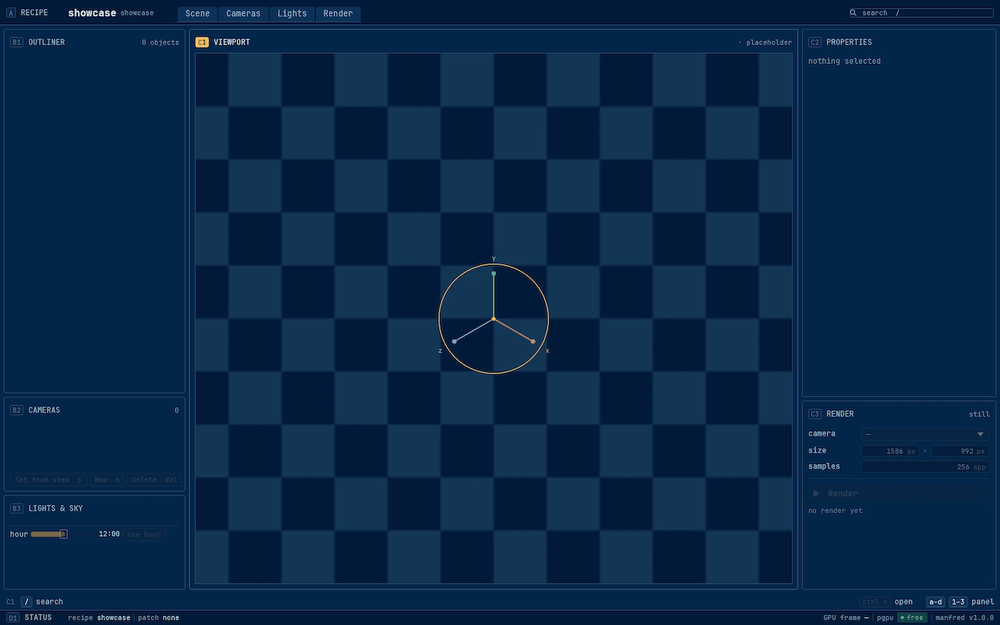
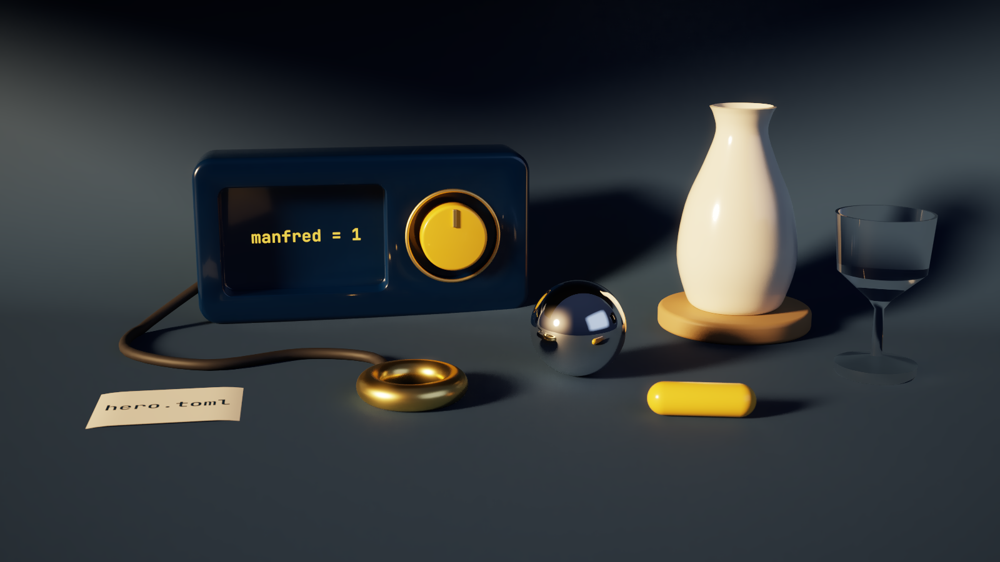
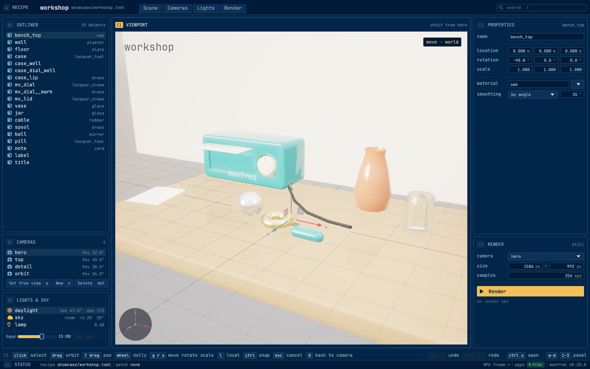
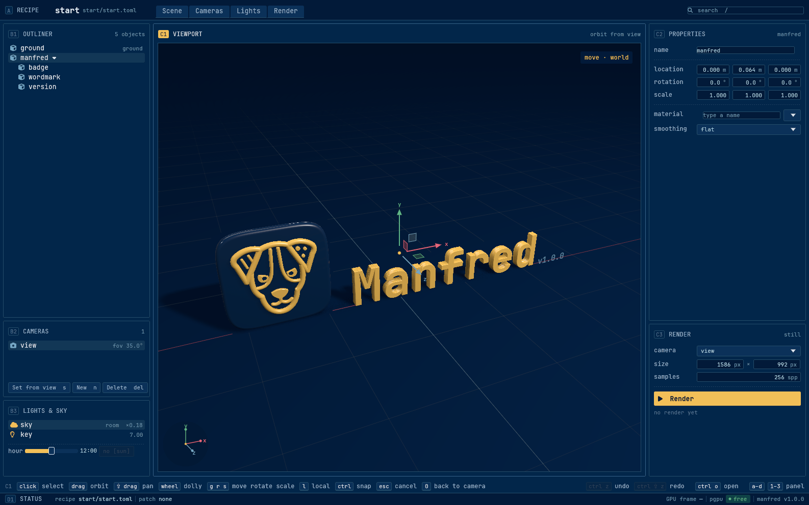

<p align="center"></p>

# Manfred

[](https://github.com/gmrdad82/manfred/actions/workflows/ci.yml) [](https://github.com/gmrdad82/manfred/tags)

Manfred is a lighter Blender, part of [PITO](https://pitomd.com): scenes as recipes, GLB headless, a live window, path-traced stills, and all of it plain data.

<p align="center"></p>

Rendered by Manfred from `showcase/hero.toml`.

## What it is

You describe a scene in a TOML recipe: its objects and how they are built, where they sit, the cameras, lights, sky, text and materials. `manfred build` turns the recipe, headless and byte for byte the same every time, into a GLB and a JSON sidecar a game or app can load. `manfred gui` shows the same recipe live in a window where you look around, arrange, light and render, and every edit you make goes back into the recipe, keeping its comments and formatting. `manfred render` path-traces a still on the GPU.

<p align="center"></p>

The window on `showcase/workshop.toml`: pick a part in the outliner or the viewport, move it with the gizmo or the panels, and the change lands in the recipe file.

It is for people and AI agents who build 3D scenes as text: a game's set dressing, product shots, app icons and cards. Recipes diff and review like code, so a scene can live in a repository next to the program that uses it. It is not a modeller: there is no sculpting and no hand mesh editing. Meshes come from Manfred's primitives and 2.5D outlines, or from generators an app writes in Rust and registers through the `manfred` library ([docs/apps.md](docs/apps.md)).

Manfred is built on [pfx](https://github.com/gmrdad82/pfx), and runs on Linux with a Vulkan GPU; the window needs Wayland.

## Install

```
cargo install --locked --git https://github.com/gmrdad82/manfred --tag vX.Y.Z manfred
```

Replace `vX.Y.Z` with a [release](https://github.com/gmrdad82/manfred/releases) tag. Building needs Rust 1.97 or newer, `pkg-config` and the Wayland client library (`libwayland-dev` on Debian and Ubuntu).

Manfred can use three optional command-line tools when they are on the `PATH`, and works without them:

- `pgpu`, a GPU queue: when it is there, renders and clips wait their turn on it; without it they run at once, paced the same way.
- `pconv`, a video encoder for `manfred clip --video`: without it the frames and their ffconcat list are written, and any encoder, such as `ffmpeg -f concat -i frames.ffconcat clip.mp4`, makes the video.
- `pfx`, the engine's tool, bakes the light probes from the bake recipe `manfred build` writes.

## A first scene

Save this as `desk.toml`:

```toml
manfred = 1
name = "desk"

[output]
glb = "desk.glb"
sidecar = "desk.json"
sidecar_dialect = "facts"

[[object]]
name = "top"
kind = "plane"
size = [1.2, 0.8]
material = "oak"

[[object]]
name = "box"
kind = "box"
at = [-0.15, 0.05, 0.0]
size = [0.2, 0.1, 0.14]
bevel = { width = 0.01, segments = 4 }
material = "blue"

[[object]]
name = "ball"
kind = "sphere"
at = [0.15, 0.05, 0.05]
radius = 0.05
material = "brass"

[[camera]]
name = "main"
position = [0.0, 0.35, 0.7]
target = [0.0, 0.03, 0.0]
fov_y_deg = 35.0

[sun]
model = "authored"
toward = [-0.45, 0.82, 0.35]
color = [1.0, 0.92, 0.82]
irradiance = 2.2

[sky]
kind = "analytic"
intensity = 0.9

[materials.oak]
family = "wood"
base = [0.42, 0.28, 0.16]
roughness = 0.55

[materials.blue]
family = "lacquer"
base = [0.08, 0.2, 0.5]
roughness = 0.3

[materials.brass]
family = "metal"
base = [0.85, 0.66, 0.35]
roughness = 0.3
metalness = 1.0
```

Then:

```
manfred check desk.toml                                         lists any problems
manfred build desk.toml --out out                               writes out/desk.glb and out/desk.json
manfred shot desk.toml --camera main --size 800x500 --out desk.png
manfred render desk.toml --camera main --spp 256 --out desk-traced.png
manfred gui desk.toml                                           opens the window
```

`manfred gui` with no recipe opens on Manfred's own mark, the badge in 3D with its wordmark; Ctrl+O picks a recipe.

<p align="center"></p>

A camera with a path turns into frames and a video with `manfred clip`, and `manfred gui --clip` films the window itself playing a tape of clicks, keys and waits: the clip at the top of this page is `showcase/tour.tape` ([docs/editing.md](docs/editing.md), "Clips of the window").

[docs/recipe.md](docs/recipe.md) is the whole schema, and [showcase/](showcase/README.md) has bigger scenes to open and render.

## Commands

```
manfred build <recipe> [--variant <name> | --all-variants] [--set key=value]... [--out <dir>]
                                                          recipe to GLB, sidecar and bake recipe
manfred check <recipe>                                       validate and list problems
manfred diff <a.glb> <b.glb> [--json] [--render --recipe <recipe> [--camera <name>] [--size WxH] [--floor <dB>]]
                                                          structure, side by side, or both drawn alike and compared by PSNR
manfred shot <recipe> --camera <name> --size WxH --out <png> [--variant <name>] [--set key=value]...
                                                          one still on the live renderer, headless; --set overrides a value the recipe has
manfred render <recipe> --camera <name> [--spp N] [--threshold T] [--min-samples N] [--draft] [--seed S] [--size WxH] [--equirect|--ortho] [--crop x,y,w,h] [--variant V] [--set key=value]... [--denoise off|on] [--master <file.png>] [--progress plain|json] --out <file.png|file.exr|file.hdr>
                                                          path-traced on the engine's tracer
manfred clip <recipe> --camera <name> --frames N --fps F --size WxH --out <dir> [--trace [--spp N]] [--variant V] [--set key=value]... [--video <file.mp4|file.webm>]
                                                          a camera moving along the recipe's path, as frames and a video
manfred gui [<recipe>|<folder>]                              the window; without a recipe, Manfred's own mark, selected on a floor grid; Ctrl+O, a picker of recipes
manfred gui [<recipe>|<folder>] --shot <png> [--size WxH] [--input <script>] [--fake] [--fixture <name>] [--start]
                                                          one frame of the window, offscreen
manfred gui [<recipe>|<folder>] --clip <dir> --tape <file> [--size WxH] [--fps 30|60|120] [--poster first|last|<seconds>] [--start]
                                                          the window playing a tape, offscreen: an x264 master, its poster and a manifest
```

`manfred --help` and `manfred help <command>` print the whole help. A line Manfred cannot parse gets clap's short error on stderr and exits 2; a recipe, camera or file it refuses after that is one line on stderr, `manfred <command>: …`, and exits 1.

## Documentation

- [DESIGN.md](DESIGN.md): the crates, the process and document models, the window.
- [docs/recipe.md](docs/recipe.md): the recipe schema.
- [docs/apps.md](docs/apps.md): linking the `manfred` library from an app's own build binary, with its generators, sidecar writer and materials.
- [docs/render.md](docs/render.md), [docs/cameras.md](docs/cameras.md), [docs/editing.md](docs/editing.md), [docs/theme.md](docs/theme.md): rendering, cameras, editing in the window, and the look.

## Build and test

```
git clone https://github.com/gmrdad82/manfred
cd manfred
bin/gate --public
```

`bin/gate --public` is what CI runs, as three jobs in parallel (`bin/gate --public lint`, `test` and `release`): `shellcheck`, `cargo fmt --check`, `cargo clippy -D warnings`, every test and doc test that needs no GPU, with the default features, and the release build. CI runs on every push and pull request and nightly. Tests that need a GPU are `#[ignore]`d; run them on a machine with a Vulkan GPU with `cargo test -- --ignored`. The checks include a licence check: every dependency must be under an MIT-compatible licence.

Manfred reports to no one: it sends no crash reports, job progress or usage anywhere.

## Contributing

Issues and pull requests are welcome. Please read the [code of conduct](CODE_OF_CONDUCT.md) first, and report a security issue privately as [SECURITY.md](SECURITY.md) says. Keep `bin/gate --public` green, add a test where a change could break something a user relies on (a recipe key, the GLB or sidecar format, a build's bytes), and keep builds deterministic: the same recipe gives the same bytes on any machine.

## Licence

The code is MIT licensed ([LICENSE](LICENSE)), © Catalin Ilinca. The Manfred and PITO names and their logos are © Catalin Ilinca, all rights reserved, and are not covered by the MIT licence ([TRADEMARKS.md](TRADEMARKS.md)). The bundled JetBrains Mono Nerd Font is under the SIL Open Font License ([assets/fonts/OFL.txt](assets/fonts/OFL.txt)).
